# 힘찬짐 PT 일정 운영 기획서와 DB 설계
2026년 11월 6일 · 한국 시간 · PT 1회당 60분

## 운영자가 결정하고 회원이 예약하기까지

| 순서 | 담당 | 결정 또는 행동 | 상대방에게 보이는 결과 |
|---|---|---|---|
| 1 | 마스터 관리자 | 센터 시작·종료 시각과 같은 시간에 가능한 PT 팀 수를 설정한다. | 정원이 찬 시각은 트레이너의 등록 후보에서 빠진다. |
| 2 | 마스터 관리자 | 트레이너별 계약 기간, 자유 등록 요일과 시간, 최소·최대 공개 횟수를 정한다. | 트레이너는 계약 기준과 등록 실적을 함께 확인한다. |
| 3 | 트레이너 | 가능한 날짜를 열고 1시간 단위 수업을 등록하거나 수정한다. | 계약 범위 안은 바로 공개한다. 기간 안에서 요일·시간이 예외인 경우 검토 목록에 올라가며 관리자 승인 후 공개한다. |
| 4 | 회원 | 이용권과 트레이너를 선택하고 달력에서 활성화된 날짜를 누른다. | 이용권 기간 안에서 본인의 다른 예약과 겹치지 않는, 트레이너가 공개한 빈 시간만 표시한다. |
| 5 | 담당 트레이너 | 회원의 예약, 또는 기존 수업의 시간 변경 요청을 검토한다. | 신규 예약 승인과 기존 일정 변경 승인은 별개다. 변경을 거절하거나 요청을 철회하면 원래 일정으로 진행한다. |
| 6 | 트레이너·회원 | 수업 상세의 이력을 확인한다. | 요청자·처리자와 한국 시각, 원래 시간과 새 시간, 이전 PT 피드백과 수정 내용을 확인한다. |

### 한도와 예외 처리

- 센터 초기 설정은 09:00~22:00, 동시 2팀이다. 운영자가 설정에서 변경할 수 있다. 22:00 종료라면 마지막 시작 후보는 21:00이다.
- 최소 횟수는 계약 기간 중 공개할 **시간의 목표**다. 진행도를 표시한다. 완료 수업 수나 강사료 산정과는 기준이 다르다.
- 최대 횟수는 같은 계약에서 승인·승인 대기인 시간의 합으로 제한한다. 이미 지난 공개 시간은 실적에 남고 거절·철회한 시간은 제외한다. 예외 요청도 시설 정원과 최대치를 넘길 수 없다.
- 센터 영업시간 밖 또는 계약 기간 밖은 등록할 수 없다. 새 기간은 별도 계약으로 등록한다. 이미 회원 예약이 걸린 시간은 트레이너가 일방적으로 옮기거나 철회할 수 없다.
- 부운영자는 데스크에서 일정을 관리한다. 센터 정책·계약 확정·계약 범위 밖 예외 승인은 마스터 관리자 권한이다.

### 10시 수업을 14시로 바꿀 때

회원이 14시를 요청해도 수업의 확정 시각은 10시다. 이때 1개의 요청만 대기할 수 있고 회원은 철회할 수 있다. 14시를 요청만으로 선점하지 않는다. 트레이너가 승인할 때 서버가 공개 여부, 자리, 회원의 다른 수업, 이용권 조건을 다시 검사한다. 자리가 사라졌으면 승인하지 않고 원래 예약을 보존한다. 승인이 성공하면 같은 예약의 시간을 바꾸므로 이용권은 추가로 차감하지 않는다. 거절된 변경 요청은 수업 자체를 취소하지 않는다. 트레이너 계정이 연결되지 않은 기존 수업은 운영자가 요청을 대신 처리할 수 있다.

## 데이터 구조

```mermaid
erDiagram
    ACCOUNTS ||--o| TRAINERS : "트레이너 로그인"
    TRAINERS ||--o{ TRAINER_CONTRACTS : "계약 및 갱신"
    TRAINER_CONTRACTS ||--o{ TRAINER_SLOTS : "계약별 가용 시간"
    TRAINERS ||--o{ TRAINER_SLOTS : "공개 주체"
    TRAINERS ||--o{ RESERVATIONS : "담당 수업"
    MEMBERS ||--o{ PASSES : "구매 이용권"
    PASSES ||--o{ RESERVATIONS : "사용 횟수"
    MEMBERS ||--o{ RESERVATIONS : "예약자"
    RESERVATIONS ||--o{ LESSON_TIME_REQUESTS : "시간 변경 신청"
    RESERVATIONS ||--o{ LESSON_HISTORY : "수업별 이력"
    ACCOUNTS ||--o{ LESSON_HISTORY : "변경자"
    ACCOUNTS ||--o{ LESSON_TIME_REQUESTS : "요청자"
```

| 테이블 | 핵심 열·제약 | 설계 이유 |
|---|---|---|
| facility_settings | 센터 1행, start_hour, end_hour, capacity | 계약이나 트레이너 수와 독립적으로 동시 PT 한도를 조정한다. |
| trainer_contracts | trainer_id FK, 시작·종료일, allowed_weekdays, 시작·종료 시각, min_slots, max_slots | 계약 기간별 실적을 보존하고 갱신 계약을 구분한다. |
| trainer_slots | trainer_id, contract_id, starts_at, status, within_scope, created_by, decided_by | 트레이너 제안과 관리자의 결정, 공개 가능한 시간을 식별한다. 같은 트레이너·시각에 활성 등록은 하나다. |
| reservations | member_id, trainer_id, pass_id, starts_at, status, approval, note | 회원 양쪽 앱이 보는 현재 일정·수업 상태·피드백이다. 기존 예약도 조회할 수 있도록 공개 시간과는 트레이너·시각으로 대응한다. |
| lesson_time_requests | reservation_id, original_start, proposed_start, requested_by/at, resolved_by/at, state | 요청한 시각을 현재 일정과 분리한다. 부분 유일 인덱스로 수업당 대기 요청을 1개로 제한한다. |
| lesson_history | reservation_id, actor_id, 당시 이름·역할, changed_at, event, previous_values, new_values | 변경과 같은 트랜잭션에서 전후값을 기록한다. 이름을 나중에 바꿔도 당시 표시 이름을 보존한다. |

센터 정원은 같은 시각의 승인·대기 가용 시간과 슬롯 없이 남아 있는 기존 수업을 트레이너별로 한 번씩 센다. 새 등록·예약·변경 승인은 트랜잭션 안에서 검사한다. 신청이나 승인에 실패하면 현재 예약과 이용권을 보존한다. 이력 조회는 회원 본인·담당 트레이너·운영 권한자에게 허용한다. 도입 전 변경자와 수정 시각은 소급 생성하지 않는다.
